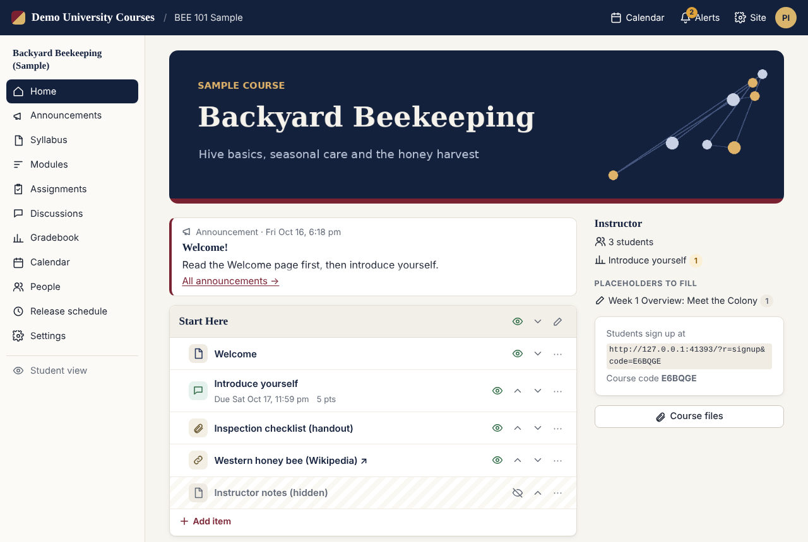
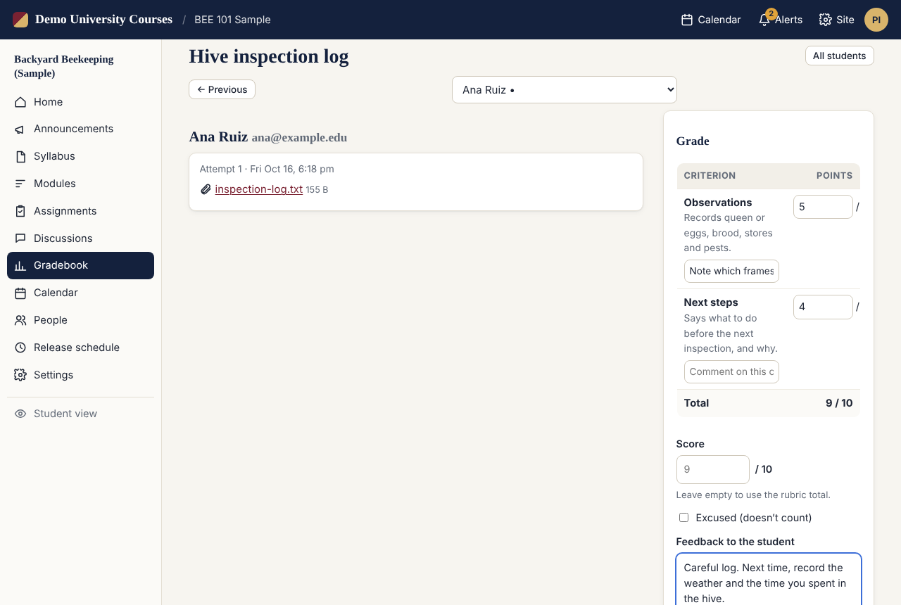
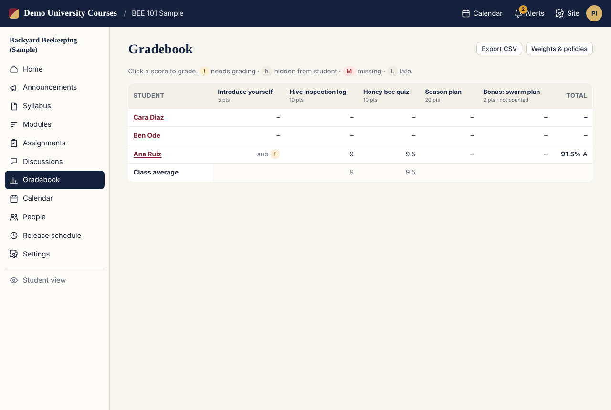
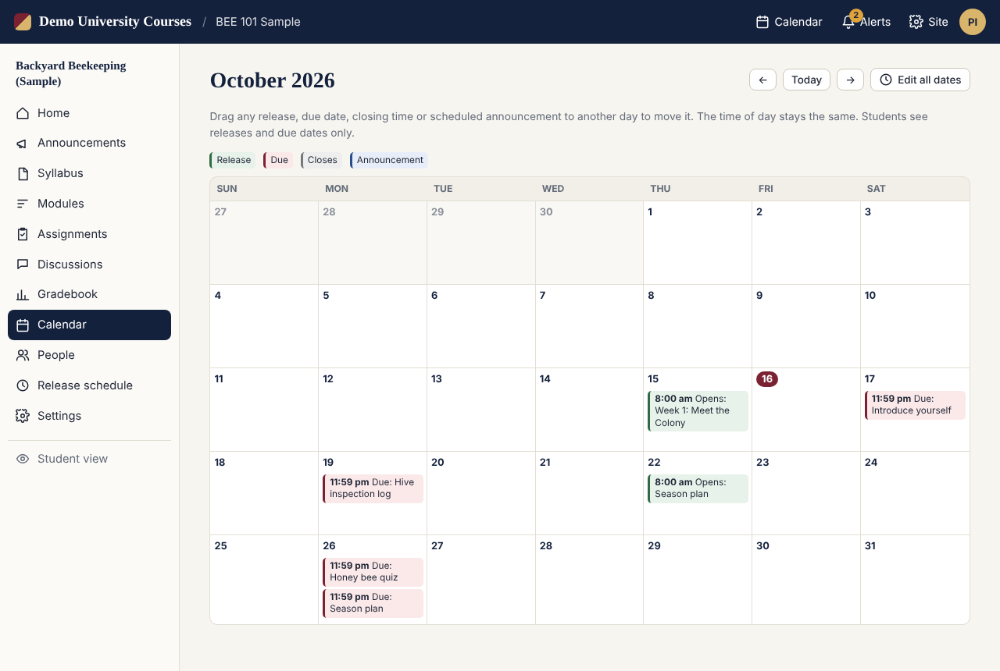
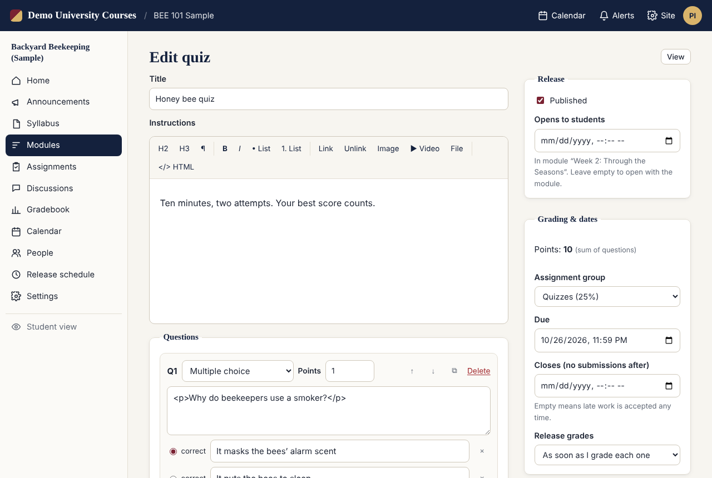
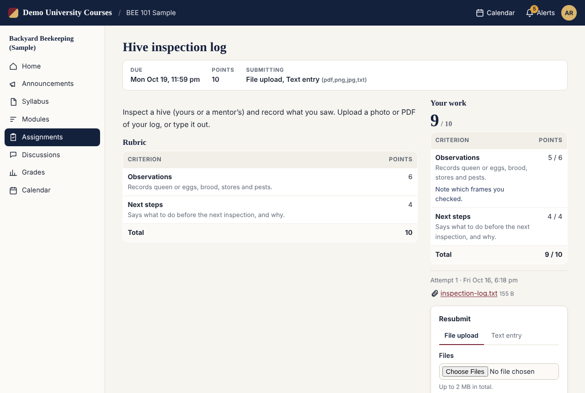
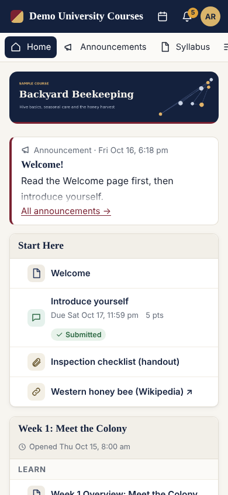

# heLMSman

**A small course site for one instructor. It runs on ordinary PHP hosting and imports Canvas courses.**

heLMSman (say "helmsman") is a learning management system for teaching on your own:
a workshop, a summer intensive, a continuing-education course, or a public version of
a class. It needs no database, no Docker and no server administration. You upload one
folder to the kind of shared web hosting that comes with a personal website, open it in
a browser, and import your Canvas course.



## What it does

- **Imports Canvas exports (.imscc):** modules, pages, the syllabus, images and files,
  assignments with groups, weights and rubrics, graded discussions, and classic quizzes.
- **Student accounts:** students sign up with a course code and you approve them, or you
  create their accounts and they set their own password when they first log in.
- **Assignments:** file upload, text entry or link. Due and closing dates, limits on
  attempts, a late penalty, rubrics, and written feedback. Grades either reach students
  as you enter them or wait until you click **Post grades**.
- **Quizzes:** multiple choice, true/false, multiple answers, short answer, number and
  essay. Optional time limit and multiple attempts; answers save as students go; you
  grade essays by hand.
- **Discussions:** threaded, optionally graded. You can require students to post before
  they see anyone else's posts.
- **Gradebook:** weighted groups, letter grades, missing work counted as zero, and
  CSV export.
- **Video lectures:** paste a YouTube, Vimeo, Google Drive, Loom or Panopto link, or
  upload a video file.
- **Release by calendar:** every module and item opens at a date and time you choose.
  Drag dates around on the calendar, edit them all on one page, or move every date at
  once when you teach the course again.
- **Announcements**, which you can schedule, and **notifications** inside the site for
  grades, feedback, replies and approvals.
- **Student view** shows you the course exactly as an approved student sees it.

| Grading with a rubric | Gradebook |
|---|---|
|  |  |
| **Release calendar** | **Quiz builder** |
|  |  |
| **What a student sees** | **On a phone** |
|  |  |

## Who it is for, and who it isn't

heLMSman fits **one instructor (or a few) and classes of up to roughly a hundred
students**. It keeps its data in files, which makes it easy to host and to back up,
but it is not built for a whole department or for thousands of users.

It deliberately leaves out:

- **Email.** Notifications appear inside the site. When a student forgets a password,
  you reset it and send them the temporary one yourself.
- **SCORM, LTI tools, plagiarism checking, and Canvas "New Quizzes".** If you use New
  Quizzes, export them from Canvas as classic quizzes first.
- **Institutional integration** (single sign-on, student information systems).

If you need those, Moodle or Canvas are the right tools. heLMSman is for when they are
more than you need, or more than your hosting can run.

## Install

**Requirements:** PHP 7.4 or newer, the standard XML extension, and a folder PHP can write to.
heLMSman includes its own fallbacks for the zip, zlib and mbstring extensions, so it works
on shared hosts that leave those out.

1. Download `helmsman-<version>.zip` from [Releases](../../releases) and unzip it.
2. Upload the `helmsman` folder to your website (you can rename it, for example to
   `courses`). Include the hidden files `.htaccess`, `.user.ini` and `lib/.htaccess`.
3. Visit the folder in your browser, for example `https://example.com/courses/`.
   The first visit creates your instructor account.
4. Click **Import Canvas course (.imscc)**. In Canvas you get this file from
   *Settings → Export Course Content*.
5. Check **Release schedule**, fill in your video links (the course home page lists
   every page that still has a placeholder like `[video link]`), and try **Student view**.
6. Share the sign-up link shown on the course home page, or add students under **People**.

Under **Site → Server check** you can see what your host supports, including the
largest file students can upload.

### Updating

Upload the new version's files over the old ones. Your courses live in the `data`
folder, which updates never touch.

### Backups

Everything (courses, accounts, submissions and grades) is in `data/`. Download that
folder regularly; to restore, upload it back.

### Keeping data outside the web folder (optional)

Copy `config.sample.php` to `config.php` and set `DATA_DIR` to a folder outside your
public web directory.

## Privacy and student records

heLMSman stores student work and grades on your server, so you are responsible for them.
Serve the site over HTTPS, keep PHP up to date, and check **Site → Server check**,
which confirms the data folder can't be downloaded directly. Follow your institution's rules. In
the US that means FERPA. Many institutions require official grades to be kept in their own
LMS; the CSV export lets you move them there. See [SECURITY.md](SECURITY.md) for how the
software protects data and how to report a problem.

## Development

The code is plain PHP with no build step and no dependencies:

```
src/            the app, the folder you deploy
  index.php     router
  lib/          core, course model, importer, views, instructor tools, compatibility fallbacks
  assets/       one CSS file and one JavaScript file
tests/
  selftest.php  CLI tests: importer, quiz scoring, grade math, zip and path safety
  e2e/run.py    browser test of the instructor and student flows (Playwright)
  fixtures/     a generated sample Canvas course
tools/build-release.sh
```

```sh
php tests/selftest.php                 # fast tests, needs only PHP
python3 tests/e2e/run.py               # full browser test (pip install playwright)
php -S localhost:8000 -t src           # try it locally
sh tools/build-release.sh              # makes dist/helmsman-<version>.zip
```

Issues and pull requests are welcome. Please keep the project small: plain PHP 7.4+,
no database, no Composer dependencies, and nothing that breaks on cheap shared hosting.

## License

[MIT](LICENSE) © 2026 David R. Koepsell
